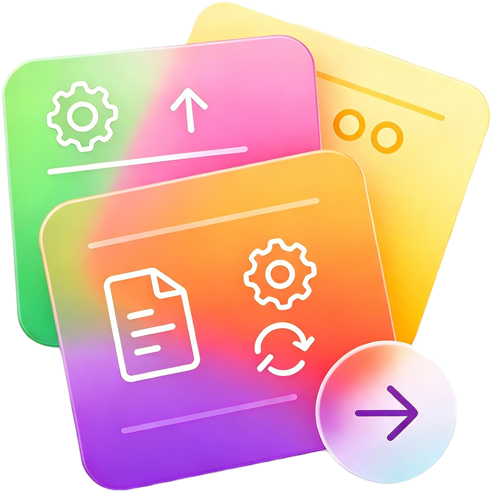

<p align="center"></p>

# FastButton-win (CornerBtn)

**RU** · [English below](#english)

Маленькая полупрозрачная кнопка в углу экрана для Windows 10, поверх всех окон.
Нужна, чтобы не целиться в крошечную «Свернуть все окна» в углу панели задач, особенно когда мониторов несколько.
Один файл `CornerBtn.exe`, без установки, без .NET. Настройки хранятся в `CornerBtn.ini` рядом с программой.

## Возможности

- **Своя кнопка на каждом мониторе**, угол и отступ настраиваются отдельно для каждого. Если монитор отключён, его настройки хранятся и вернутся при подключении.
- **Левый клик, двойной левый клик, средняя кнопка** с разными действиями. Правый клик открывает меню.
- **Свернуть окна только на том мониторе, где нажата кнопка**, и вернуть их вторым нажатием. Окна на других виртуальных рабочих столах не трогаются; окна «поверх всех» сворачиваются (можно отключить в меню).
- **Закрепить активное окно** (пункт меню или действие `@pin`): «поверх всех окон» и/или «на всех виртуальных рабочих столах», каждый режим включается отдельно (Настройки → Закрепление окна). Закреплённые окна после смены виртуального стола поднимаются наверх (опция).
- **Значок в трее**: левый клик показывает/скрывает кнопку в углу, правый открывает меню со статусом и настройками. Тот же переключатель есть на верхнем уровне меню кнопки.
- **Меню «Скопировать»**: заголовок активного окна, имя exe, имя exe с аргументами, полный путь к exe, открыть расположение exe в проводнике (с выделением файла).
- **Исключения**: список программ, при активном окне которых кнопка на этом мониторе скрывается (игры, плееры).
- **Работа с RDP/VNC**: действия `@mondesk`, `@desktop`, `@minall` работают через API и не зависят от клавиатуры. Для клавиатурных действий (Win+Tab), если в фокусе mstsc/vncviewer, фокус сначала переходит на локальный компьютер. Настраивается.
- **Три раздела меню** со своими иерархиями (категории любой вложенности, разделители, сортировка): **Программы**, **Скрипты и команды**, **Папки** (быстрый доступ, например категория «Фото» с несколькими путями).
- **Раздел «Файлы»**: любые файлы для быстрого открытия, тоже с категориями. Скрипты из этого раздела открываются в текстовом редакторе (по умолчанию Блокнот, свой редактор задаётся в «Настройки → Общее»), остальные файлы — как обычно; для пункта можно указать программу, которой его открывать.
- **Подсказка у пункта меню**: аннотация, а если она не задана, то полный путь к файлу/папке.
- **Правая кнопка на пункте меню** (программа, скрипт, папка, файл), основное меню при этом остаётся открытым: контекстное меню Explorer, «Показать в папке», «Скопировать путь» (с аргументами запуска), «Скопировать» (сам файл в буфер обмена), «Свойства», «Открыть в блокноте» (для скриптов).
- **Средняя кнопка на пункте меню**: действие выбирается в «Настройки → Общее» (по умолчанию «Показать в папке»; также копировать путь, копировать файл, меню Explorer, свойства, открыть в редакторе, ничего). Ключ `MenuMiddleClick` в `.ini`.
- **Смена виртуального рабочего стола по кругу**: действие «Следующий виртуальный рабочий стол (по кругу)» назначается на любую кнопку/жест; с последнего стола возвращается на первый. При смене стола показывается полупрозрачный оверлей с номером (вкладка «Рабочие столы»: шрифт, размер, положение, прозрачность, цвет и обводка, время показа; секция `[DeskOverlay]` в `.ini`).
- **Скрипты на клики кнопки** (клик, двойной клик, средняя кнопка): в «Действия кнопки → Изменить…» выберите «Открыть файл / папку / ссылку / программу» и укажите .bat, .cmd, .vbs, .js, .ps1 (PowerShell запускается явно). Галочка «Запускать без окна» скрывает консоль; ключ `Hide` в `.ini`.
- **Кнопка и значок в трее в виде номера рабочего стола**: «Внешний вид → Содержимое кнопки» (цвет / иконка / номер стола); вкладка «Номер стола»: шрифт, размер цифры, цвета цифры и фона (обычное состояние и при наведении), отдельный значок в трее со своими шрифтом и цветами. Секции `[NumButton]`, `[NumTray]` в `.ini`.
- **Действия на клики по значку в трее** (левый клик, двойной, средняя кнопка; правая — меню трея): вкладка «Действия кнопки», отдельные настройки или галочка «Те же действия, что у кнопки в углу». По умолчанию левый клик — «Показать / скрыть кнопку в углу». Секции `[TrayClick]`, `[TrayDoubleClick]`, `[TrayMiddleClick]`, ключ `TrayDupActions`.
- **Имя пункта подставляется само** из имени выбранной папки/файла, если поле имени пусто; если имя уже введено, оно не меняется.
- **Иконки в меню**: берутся из самой программы/файла/папки или задаются вручную (`.ico`, `.exe`, `.dll`, можно «путь,номер»).
- **Скрипты и команды**: `.bat/.cmd` (через cmd), `.vbs/.js/.wsf/.wsh` (через wscript), `.ps1` (через PowerShell), остальное по ассоциации; свой интерпретатор (например `python.exe -u`), аргументы, запуск от администратора, скрытое окно, **аннотация** (подсказка при наведении на пункт).
- **Окно «Настройки»** (пункт «Настройки…» в меню) со вкладками: Программы, Скрипты и команды, Папки, Внешний вид, Действия кнопки, Мониторы, Закрепление окон, Исключения, Общее.
- **Drag&Drop**: файлы и папки из проводника можно перетаскивать прямо в списки разделов и в поля путей.
- **Одинаковое меню** на кнопке и в трее.
- Размер, цвет, прозрачность (и при наведении), форма (квадрат/круг), иконка (`.ico`, `.exe`, `.dll`). Значок самой программы на кнопке: в поле иконки укажите `@app` (кнопка «Значок программы»).
- Shift + перетаскивание перемещает кнопку внутри её монитора.
- Автозапуск с Windows (галочка в меню).

## Использование

Скачайте `CornerBtn.exe` из [Releases](../../releases) и запустите. Кнопка 8×8 пикселей появится в углу каждого монитора (на основном слева сверху, на остальных справа сверху).

| Действие | По умолчанию |
|---|---|
| Левый клик | свернуть / вернуть окна на этом мониторе |
| Двойной клик | обзор задач (Win+Tab) |
| Средняя кнопка | нет действия |
| Правый клик | меню |

Встроенные действия: `@mondesk`, `@desktop`, `@minall`, `@taskview`, `@pin`, `@taskmgr`, `@lock`, `@none`. Любое другое значение считается путём к файлу, папке или ссылке.

## Известные ограничения

- Над приложениями в «эксклюзивном» полноэкранном режиме (часть игр) Windows не показывает чужие окна. Кнопка там не видна.
- Закрепление на всех рабочих столах использует недокументированный интерфейс Windows. На другой сборке Windows оно может не сработать; закрепление «поверх всех» при этом работает.
- Программа не подписана, Windows Defender/SmartScreen может предупредить.
- Если что-то работает не так: Настройки → «Журнал диагностики», повторите действие, затем «Скопировать журнал в буфер обмена».

## Сборка

В репозитории настроена сборка в GitHub Actions (mingw-w64, кросс-компиляция на Linux). Локально:

```sh
cd src
x86_64-w64-mingw32-windres app.rc -O coff -o app.res.o
x86_64-w64-mingw32-gcc -municode -mwindows -O2 -o CornerBtn.exe CornerBtn.c app.res.o -static \
  -lcomctl32 -lcomdlg32 -lshell32 -lole32 -loleaut32 -ladvapi32 -luser32 -lgdi32 -ldwmapi -luuid -s
```

Релиз создаётся автоматически при push тега `v*` (например `v2.0.0`).

---

## English

A tiny semi-transparent always-on-top button in a screen corner for Windows 10, a big easy target instead of the thin "Show desktop" sliver of the taskbar. Single `CornerBtn.exe`, no installer, settings in `CornerBtn.ini` next to the exe.

- One button **per monitor**, with its own corner and offset; settings are remembered for monitors that are disconnected.
- Left click / double click / middle click actions, right click opens a user-editable menu (nested folders, separators, ordering).
- **Minimize windows only on the monitor where the button was clicked** (second click restores). Windows on other virtual desktops and pinned windows are left alone.
- **Pin active window**: always on top and shown on all virtual desktops (uses undocumented Windows COM interfaces, written for Windows 10 and may not work on other builds).
- **Exclusion list**: hide the button on a monitor while a listed program is active there.
- **RDP/VNC friendly**: window actions go through APIs, and keyboard-based actions first move focus to the local machine when a remote client is active.
- Configurable size, color, opacity (and hover opacity), shape and icon. Shift+drag moves the button within its monitor.

Build: GitHub Actions cross-compiles with mingw-w64; see `.github/workflows/build.yml`. Pushing a `v*` tag publishes a release.

License: MIT
